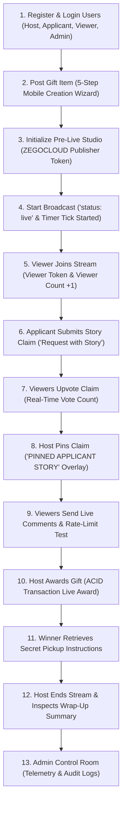

# 🚀 TONYPILOT BACKEND — FULL API & TESTING INTEGRATION GUIDE
> **Target Audience:** Frontend Developers (React / Next.js / React Native), Flutter (Mobile) Engineers, QA Engineers, and Backend Maintainers.  
> **Documentation Version:** `v1.0.0 (Production Ready)`  
> **Base URL:** `http://localhost:5000/api/v1` (Development) / `https://api.tonypilot.com/api/v1` (Production)  
> **Socket.IO Gateway:** `ws://localhost:5000` / `http://localhost:5000`  
> **Language / ভাষা:** English + সহজ বোধগম্য Banglish (Frontend & Flutter টিম যাতে এক নজরে সব বুঝতে পারে)।

---

## 📑 সূচিপত্র (Table of Contents)
1. [General Integration Rules & Conventions (হেডার, অথেন্টিকেশন ও রেসপন্স ফরম্যাট)](#1-general-integration-rules--conventions)
2. [Real-Time Socket.IO Architecture & Event Contract (সকেট সংযোগ ও ইভেন্ট তালিকা)](#2-real-time-socketio-architecture--event-contract)
3. [Module 0: Authentication & User Profile APIs](#3-module-0-authentication--user-profile-apis)
4. [Module 1: Subscriptions & Stripe Billing APIs (Phase 1)](#4-module-1-subscriptions--stripe-billing-apis-phase-1)
5. [Module 2: Gift Items Inventory & 5-Step Creation Wizard APIs (Phase 2)](#5-module-2-gift-items-inventory--5-step-creation-wizard-apis-phase-2)
6. [Module 3: Live Streaming Engine & ZEGOCLOUD RTC APIs (Phase 3)](#6-module-3-live-streaming-engine--zegocloud-rtc-apis-phase-3)
7. [Module 4: Story Claims, Community Voting & Live Winner Selection APIs (Phase 4)](#7-module-4-story-claims-community-voting--live-winner-selection-apis-phase-4)
8. [Module 5: Real-Time Live Comments, Documents & Moderation Flagging APIs (Phase 5)](#8-module-5-real-time-live-comments-documents--moderation-flagging-apis-phase-5)
9. [Module 6: Admin Dashboard Control Room, Moderation Overrides & Telemetry APIs (Phase 6)](#9-module-6-admin-dashboard-control-room-moderation-overrides--telemetry-apis-phase-6)
10. [Module 7: 1-to-1 & Group Chat Messaging APIs](#10-module-7-1-to-1--group-chat-messaging-apis)
11. [A-to-Z Step-by-Step Testing Guide (কীভাবে পুরো অ্যাপ স্টেপ বাই স্টেপ টেস্ট করবেন)](#11-a-to-z-step-by-step-testing-guide)
12. [Flutter Mobile Integration Snippets (ZEGOCLOUD + Socket.IO + Multipart Upload)](#12-flutter-mobile-integration-snippets)
13. [Frontend / React Integration Snippets (Socket.IO Hook & Event Listeners)](#13-frontend--react-integration-snippets)
14. [Global Error Codes & HTTP Status Dictionary](#14-global-error-codes--http-status-dictionary)

---

## 1. General Integration Rules & Conventions

### 🔒 Authentication Header
Public এন্ডপয়েন্ট বাদে বাকি সব এন্ডপয়েন্টে Bearer Token পাঠাতে হবে:
```http
Authorization: Bearer <your_jwt_access_token>
Content-Type: application/json
```
> [!IMPORTANT]
> যেসকল API তে ছবি বা ফাইল আপলোড (`multipart/form-data`) করতে হয়, সেগুলোতে JSON ডাটা `data` ফিল্ডে stringify করে পাঠাতে হয় অথবা ডিরেক্ট ফর্ম ফিল্ড হিসেবে দিতে হয় (Express Middleware `parseData()` automatically parses it)।

### 📦 Standard Success Response Format
```json
{
  "success": true,
  "statusCode": 200,
  "message": "Operation successful message",
  "data": { ... }
}
```

### ⚠️ Standard Error Response Format
```json
{
  "success": false,
  "statusCode": 400,
  "message": "Detailed error message",
  "errorSources": [
    {
      "path": "field_name",
      "message": "Validation rule violated"
    }
  ]
}
```

---

## 2. Real-Time Socket.IO Architecture & Event Contract

TonyPilot রিয়েল-টাইম লাইভ স্ট্রিমিং, টাইমার এবং চ্যাটের জন্য **Socket.IO** ব্যবহার করে।

### 🔌 Socket Connection & Handshake
- **Connection URL:** `http://localhost:5000`
- **Auth Query / Header:**
```javascript
const socket = io("http://localhost:5000", {
  auth: {
    token: "Bearer <your_jwt_access_token>"
  },
  transports: ["websocket"]
});
```

### 🏠 Socket Rooms Conventions
| Room Name Pattern | উদ্দেশ্য (Purpose) |
| :--- | :--- |
| `stream:<streamId>` | নির্দিষ্ট একটি লাইভ স্ট্রিমের সকল দর্শক, হোস্ট ও অ্যাডমিন এই রুমে যুক্ত থাকে। লাইভ চ্যাট, পিন ও উইনার এনাউন্সমেন্ট এই রুমে ব্রডকাস্ট হয়। |
| `user:<userId>` | নির্দিষ্ট ইউজারের পার্সোনাল রুম। ব্যক্তিগত নোটিফিকেশন (যেমন: আপনি গিফট জিতেছেন, ওয়ার্নিং ইত্যাদি) এখানে পাঠানো হয়। |
| `chat:<chatId>` | ১-টু-১ অথবা গ্রুপ চ্যাট মেসেজিং রুম। |

---

### 📡 Complete Socket Event Matrix (Client ⟷ Server)

#### A. Client-to-Server Events (অ্যাপ থেকে পাঠাবেন)
| Event Name | Payload | Callback Response | কাজ ও বর্ণনা (Purpose) |
| :--- | :--- | :--- | :--- |
| `join_stream` | `{ "streamId": "65f..." }` | `{ "success": true, "viewerCount": 42 }` | লাইভ স্ট্রিম রুমে জয়েন করে। Redis এ রিয়েল-টাইম ইউনিক ভিউয়ার কাউন্ট বৃদ্ধি পায়। |
| `leave_stream` | `{ "streamId": "65f..." }` | `{ "success": true }` | লাইভ স্ট্রিম রুম থেকে বের হয়ে যায় এবং ভিউয়ার কাউন্ট আপডেট হয়। |

#### B. Server-to-Client Broadcast Events (অ্যাপে Listen করবেন)
| Event Name | Room Broadcast | Payload Data | UI এ যা করতে হবে (UI Action) |
| :--- | :--- | :--- | :--- |
| `viewer_count_update` | `stream:<streamId>` | `{ "streamId": "...", "viewerCount": 25 }` | টপবারে লাইভ দর্শক সংখ্যা রিয়েলটাইমে আপডেট করুন। |
| `timer_tick` | `stream:<streamId>` | `{ "streamId": "...", "remainingSeconds": 340, "elapsedSeconds": 260, "totalDurationSeconds": 600 }` | স্ক্রিনে রিয়েল-টাইম কাউন্টডাউন টাইমার (05:40) চালান। সার্ভার প্রতি সেকেন্ডে এটি পাঠায়। |
| `timer_expired` | `stream:<streamId>` | `{ "streamId": "...", "message": "Broadcast timer has reached 0" }` | হোস্টকে সতর্ক করুন বা স্বয়ংক্রিয়ভাবে উইনার সিলেকশন মডেল খুলুন। |
| `stream_status_changed`| `stream:<streamId>` | `{ "streamId": "...", "status": "live", "startedAt": "..." }` | প্রি-লাইভ স্ক্রিন থেকে মেইন লাইভ ব্রডকাস্ট স্ক্রিনে সুইচ করুন। |
| `stream_ended` | `stream:<streamId>` | `{ "streamId": "...", "status": "ended", "endedAt": "..." }` | লাইভ স্ট্রিম শেষ হয়েছে। সকল দর্শককে "Broadcast Finished" Wrap-up স্ক্রিনে নিয়ে যান। |
| `new_story_claim` | `stream:<streamId>` | `{ "_id": "...", "applicant": { "name": "..." }, "storyText": "..." }` | নতুন একজন গল্প সাবমিট করেছে। হোস্টের বটম শিট এবং দর্শকদের ভোটিং লিস্টে নতুন গল্প যোগ করুন। |
| `story_claim_pinned` | `stream:<streamId>` | `{ "_id": "...", "storyText": "...", "applicant": { ... } }` | স্ক্রিনের উপরে/নিচে "PINNED APPLICANT STORY" ওভারলে ব্যানার হিসেবে ডিসপ্লে করুন। |
| `story_claim_unpinned` | `stream:<streamId>`| `{ "streamId": "...", "claimId": "..." }` | পিন করা স্টোরি ওভারলে ব্যানার স্ক্রিন থেকে সরিয়ে ফেলুন। |
| `claim_vote_updated` | `stream:<streamId>` | `{ "streamId": "...", "claimId": "...", "voteCount": 18 }` | স্টোরির পাশে লাইভ আপভোট কাউন্টার রিয়েল-টাইমে আপডেট করুন। |
| `gift_awarded` | `stream:<streamId>` | `{ "streamId": "...", "claimId": "...", "winner": { "name": "..." }, "giftItem": { "title": "..." }, "awardedAt": "..." }` | **GIFT AWARDED LIVE!** কনফেটি / সেলিব্রেশন অ্যানিমেশন প্লে করুন এবং বিজয়ীর নাম বড় করে দেখান। |
| `you_won_gift` | `user:<applicantId>` | `{ "streamId": "...", "claimId": "...", "giftItem": { ... }, "pickupInstructions": "..." }` | বিজয়ীর মোবাইলে পুশ ডায়ালগ ওপেন করুন: "অভিনন্দন! আপনি গিফট জিতেছেন! পিকআপ ইন্সট্রাকশন দেখুন।" |
| `new_live_comment` | `stream:<streamId>` | `{ "_id": "...", "user": { "name": "..." }, "comment": "...", "reactionEmoji": "❤️" }` | লাইভ চ্যাট ফিডে নতুন কমেন্ট বা ভাসমান ইমোজি অ্যানিমেশন দেখান। |
| `comment_pinned` | `stream:<streamId>` | `{ "_id": "...", "comment": "...", "user": { ... } }` | চ্যাট বক্সের শীর্ষে হাইলাইটেড কমেন্ট পিন করে রাখুন। |
| `comment_unpinned` | `stream:<streamId>` | `{ "commentId": "...", "streamId": "..." }` | পিন করা কমেন্ট আনপিন করুন। |
| `comment_deleted` | `stream:<streamId>` | `{ "commentId": "...", "streamId": "..." }` | মডারেশন দ্বারা ডিলিট হওয়া কমেন্ট তৎক্ষণাৎ ভিউয়ারদের চ্যাটলিস্ট থেকে হাইড করুন। |
| `admin_force_end_stream`| `stream:<streamId>`| `{ "streamId": "...", "reason": "TOS violation", "terminatedAt": "..." }` | অ্যাডমিন কর্তৃক স্ট্রিম জোরপূর্বক বন্ধ করা হয়েছে। লাল নোটিশ দেখিয়ে স্ট্রিম বন্ধ করুন। |
| `admin_host_muted` | `stream:<streamId>` | `{ "streamId": "...", "isMuted": true, "reason": "Audio violation" }` | হোস্টের অডিও মিউট করে দিন এবং মাইক্রোফোন আইকন রেড ক্রস করুন। |
| `admin_warning_issued` | `user:<userId>` | `{ "reason": "Inappropriate comment", "warningCount": 1 }` | ইউজারের স্ক্রিনে রেড অ্যালার্ট ওয়ার্নিং পপআপ দিন। |

---

## 3. Module 0: Authentication & User Profile APIs

### 1. User Registration (সাইন আপ)
- **Method:** `POST`
- **URL:** `/auth/create` (অথবা `/users/create`)
- **Headers:** `Content-Type: application/json`
- **Body:**
```json
{
  "name": "Rahim Khan",
  "email": "rahim@example.com",
  "password": "Password123#",
  "phone": "+8801700000000"
}
```
- **Response (201):**
```json
{
  "success": true,
  "statusCode": 201,
  "message": "User registered successfully. Please verify your OTP.",
  "data": {
    "email": "rahim@example.com"
  }
}
```

### 2. Verify Registration OTP
- **Method:** `POST`
- **URL:** `/users/create-user-verify-otp`
- **Body:**
```json
{
  "email": "rahim@example.com",
  "otp": 1234
}
```

### 3. User Login
- **Method:** `POST`
- **URL:** `/auth/login`
- **Body:**
```json
{
  "email": "rahim@example.com",
  "password": "Password123#"
}
```
- **Response (200):**
```json
{
  "success": true,
  "statusCode": 200,
  "message": "User logged in successfully",
  "data": {
    "accessToken": "eyJhbGciOi...",
    "refreshToken": "eyJhbGciOi...",
    "user": {
      "_id": "65fc1234567890abcdef1234",
      "name": "Rahim Khan",
      "email": "rahim@example.com",
      "role": "user",
      "profileStatus": "active"
    }
  }
}
```

### 4. Refresh Token
- **Method:** `POST`
- **URL:** `/auth/refresh-token`
- **Body:**
```json
{
  "refreshToken": "eyJhbGciOi..."
}
```

### 5. Social Login (Google / Apple)
- **Method:** `POST`
- **URL:** `/auth/create-or-login-google-user` (বা `/auth/create-or-login-apple-user`)
- **Body:**
```json
{
  "email": "user@gmail.com",
  "name": "Rahim Khan",
  "image": "https://lh3.googleusercontent.com/...",
  "googleId": "10982347091283"
}
```

### 6. Get My Profile
- **Method:** `GET`
- **URL:** `/users/my-profile`
- **Headers:** `Authorization: Bearer <token>`

### 7. Complete / Update Profile (with Avatar Upload)
- **Method:** `PATCH`
- **URL:** `/users/update-my-profile`
- **Headers:** `Authorization: Bearer <token>`, `Content-Type: multipart/form-data`
- **Form Data:**
  - `image`: *(File Binary)*
  - `data`: `{"name": "Rahim Chowdhury", "bio": "Passionate Giver", "address": "Banani, Dhaka"}`

---

## 4. Module 1: Subscriptions & Stripe Billing APIs (Phase 1)

> **Features Included:** 1-Month Auto-Renewal, Card Save (SetupIntent), Stripe Webhook auto-activation & cancellation, Tier Quota enforcement.  
> 🔗 **Stripe Webhook Setup Guide:** বিস্তারিত Webhook Scope, Snapshot Payload, এবং Event list-এর জন্য দেখুন [STRIPE_WEBHOOK_SETUP_GUIDE.md](./STRIPE_WEBHOOK_SETUP_GUIDE.md)।

### 1. Get All Active Subscription Plans (পাবলিক প্ল্যান লিস্ট)
- **Method:** `GET`
- **URL:** `/subscriptions/plans`
- **Auth:** Public
- **Response (200):**
```json
{
  "success": true,
  "statusCode": 200,
  "message": "Subscription plans fetched successfully",
  "data": [
    {
      "_id": "65f011111111111111111111",
      "name": "Basic Host",
      "tier": "basic",
      "price": 19.99,
      "currency": "usd",
      "billingInterval": "month",
      "features": {
        "monthlyGiftLimit": 10,
        "maxLiveStreamDurationMinutes": 60,
        "analyticsAccess": true
      }
    },
    {
      "_id": "65f022222222222222222222",
      "name": "Pro Host",
      "tier": "pro",
      "price": 49.99,
      "billingInterval": "month",
      "features": {
        "monthlyGiftLimit": 50,
        "maxLiveStreamDurationMinutes": 180,
        "priorityBadge": true
      }
    }
  ]
}
```

### 2. Create Stripe Checkout Session (সাবস্ক্রিপশন কেনা / রিনিউয়াল)
> [!NOTE]
> `saveCard: true` পাঠালে Stripe গ্রাহকের ক্রেডিট কার্ড সেভ করে রাখবে এবং প্রতি মাসে স্বয়ংক্রিয়ভাবে রিনিউ হবে।
- **Method:** `POST`
- **URL:** `/subscriptions/checkout-session`
- **Headers:** `Authorization: Bearer <token>`
- **Body:**
```json
{
  "planId": "65f011111111111111111111",
  "saveCard": true,
  "successUrl": "https://yourapp.com/payment/success?session_id={CHECKOUT_SESSION_ID}",
  "cancelUrl": "https://yourapp.com/payment/cancel"
}
```
- **Response (200):**
```json
{
  "success": true,
  "statusCode": 200,
  "message": "Checkout session created successfully",
  "data": {
    "sessionId": "cs_test_a1b2c3...",
    "checkoutUrl": "https://checkout.stripe.com/c/pay/cs_test_a1b2c3..."
  }
}
```
*(Frontend / Flutter: Open this `checkoutUrl` in WebView or In-App Browser).*

### 3. Get My Subscription Status
- **Method:** `GET`
- **URL:** `/subscriptions/my-status`
- **Headers:** `Authorization: Bearer <token>`
- **Response (200):**
```json
{
  "success": true,
  "statusCode": 200,
  "message": "Subscription status fetched successfully",
  "data": {
    "hasActiveSubscription": true,
    "tier": "basic",
    "status": "active",
    "autoRenew": true,
    "currentPeriodEnd": "2026-11-27T09:00:00.000Z",
    "monthlyGiftsRemaining": 8,
    "defaultPaymentMethod": {
      "brand": "visa",
      "last4": "4242",
      "expMonth": 12,
      "expYear": 2028
    }
  }
}
```

### 4. Create Card SetupIntent (কার্ড সেভ করার জন্য)
- **Method:** `POST`
- **URL:** `/subscriptions/setup-intent`
- **Headers:** `Authorization: Bearer <token>`
- **Response (200):**
```json
{
  "success": true,
  "statusCode": 200,
  "message": "SetupIntent created successfully",
  "data": {
    "clientSecret": "seti_1P..._secret_...",
    "customerId": "cus_Rn8..."
  }
}
```

### 5. Get Saved Payment Methods (সেভ করা কার্ড তালিকা)
- **Method:** `GET`
- **URL:** `/subscriptions/payment-methods`
- **Headers:** `Authorization: Bearer <token>`
- **Response (200):**
```json
{
  "success": true,
  "data": [
    {
      "id": "pm_1Pq...",
      "brand": "visa",
      "last4": "4242",
      "expMonth": 8,
      "expYear": 2029,
      "isDefault": true
    }
  ]
}
```

### 6. Toggle Auto-Renew (স্বয়ংক্রিয় রিনিউ চালু/বন্ধ)
- **Method:** `PATCH`
- **URL:** `/subscriptions/auto-renew`
- **Headers:** `Authorization: Bearer <token>`
- **Body:**
```json
{
  "autoRenew": false
}
```

### 7. Cancel Subscription (সাবস্ক্রিপশন বাতিল করা)
- **Method:** `POST`
- **URL:** `/subscriptions/cancel`
- **Headers:** `Authorization: Bearer <token>`
- **Body:**
```json
{
  "cancelImmediately": false,
  "reason": "Not streaming this month"
}
```

---

## 5. Module 2: Gift Items Inventory & 5-Step Creation Wizard APIs (Phase 2)

> **5-Step Mobile Creation Wizard:**
> 1. General Info (Title, Category, Description)
> 2. Condition & Valuation (Condition, Estimated Value)
> 3. Pickup Rules & Secret Instructions (Private until won)
> 4. Location Details (GeoJSON Point: [Longitude, Latitude], City, Zip)
> 5. Image Uploads (Up to 5 Photos)

### 1. Create Gift Item (5-Step Wizard Submit)
- **Method:** `POST`
- **URL:** `/gift-items`
- **Headers:** `Authorization: Bearer <token>`, `Content-Type: multipart/form-data`
- **Form Data:**
  - `images`: *(File Binary array - up to 5 images)*
  - `data`: *(JSON Stringified)*
```json
{
  "title": "Sony Alpha A7 III Full Frame Camera",
  "category": "electronics",
  "description": "Mint condition camera with 28-70mm lens kit.",
  "condition": "like_new",
  "estimatedValue": 1200,
  "pickupInstructions": "Meet at Banani Starbucks or DHL courier handover.",
  "pickupAddress": {
    "address": "Banani, Dhaka",
    "location": {
      "type": "Point",
      "coordinates": [90.4125, 23.8103]
    }
  }
}
```
- **Response (201):**
```json
{
  "success": true,
  "statusCode": 201,
  "message": "Gift item created successfully",
  "data": {
    "_id": "65f2a1b2c3d4e5f6a7b8c901",
    "title": "Sony Alpha A7 III Full Frame Camera",
    "status": "available",
    "images": [
      "/uploads/gifts/gift-1730000001.jpg"
    ],
    "donor": "65fc1234567890abcdef1234",
    "createdAt": "2026-10-27T09:30:00.000Z"
  }
}
```

### 2. Discover Public Available Gifts (Geospatial 25-Mile Feed)
> [!TIP]
> ব্যবহারকারীর বর্তমান অক্ষাংশ ও দ্রাঘিমাংশ (`lat`, `lng`) পাঠালে ২৫ মাইল ব্যাসার্ধের ভেতরের গিফটগুলো আগে ফিল্টার হয়ে আসে।
- **Method:** `GET`
- **URL:** `/gift-items/public?lng=90.4125&lat=23.8103&radiusMiles=25&category=electronics&page=1&limit=10`
- **Auth:** Public
- **Response (200):**
```json
{
  "success": true,
  "statusCode": 200,
  "message": "Available gifts retrieved successfully",
  "data": [
    {
      "_id": "65f2a1b2c3d4e5f6a7b8c901",
      "title": "Sony Alpha A7 III Full Frame Camera",
      "category": "Electronics",
      "condition": "like_new",
      "images": ["/uploads/gifts/gift-1730000001.jpg"],
      "donor": {
        "name": "Rahim Khan",
        "image": "/uploads/profile/rahim.jpg"
      },
      "location": {
        "address": "Banani, Dhaka",
        "city": "Dhaka"
      }
    }
  ],
  "meta": {
    "page": 1,
    "limit": 10,
    "total": 1
  }
}
```

### 3. Get My Gift Items (আমার গিফট তালিকা)
- **Method:** `GET`
- **URL:** `/gift-items/my-items?status=available`
- **Headers:** `Authorization: Bearer <token>`

### 4. Get Gift Details
- **Method:** `GET`
- **URL:** `/gift-items/:id`
- **Auth:** Public

### 5. Update Gift Item
- **Method:** `PATCH`
- **URL:** `/gift-items/:id`
- **Headers:** `Authorization: Bearer <token>`, `Content-Type: multipart/form-data`

### 6. Delete Gift Item (Soft Delete)
- **Method:** `DELETE`
- **URL:** `/gift-items/:id`
- **Headers:** `Authorization: Bearer <token>`

---

## 6. Module 3: Live Streaming Engine & ZEGOCLOUD RTC APIs (Phase 3)

> **Key Capabilities:**
> - ZEGOCLOUD Token04 Generation (AES-256-GCM Cryptographic Signature).
> - Server-Authoritative 1-Second Timer (`timer_tick` on Socket.IO).
> - Host Monthly Streaming Quota Protection.
> - Audience Viewer Management & Redis In-Memory Counter.  
> 🔗 **ZEGOCLOUD Console & Pricing Guide:** ক্লায়েন্টকে বোঝানো, AppID/ServerSecret সংগ্রহ এবং খরচের বিস্তারিত জানতে দেখুন [ZEGOCLOUD_CREDENTIALS_AND_PRICING_GUIDE.md](./ZEGOCLOUD_CREDENTIALS_AND_PRICING_GUIDE.md)।

### 1. Initialize Pre-Live Studio Session (প্রি-লাইভ স্টুডিও ইনিশিয়ালাইজেশন)
> হোস্ট লাইভে যাওয়ার আগে ক্যামেরা/মাইক টেস্ট করতে প্রি-লাইভ স্টুডিও ওপেন করবে। ব্যাকএন্ড ZEGOCLOUD পাবলিশার প্রিভিলেজ টোকেন ও রুম আইডি তৈরি করবে।
- **Method:** `POST`
- **URL:** `/live-streams/pre-live-init`
- **Headers:** `Authorization: Bearer <token>`
- **Body:**
```json
{
  "giftItemId": "65f2a1b2c3d4e5f6a7b8c901",
  "channelName": "Giving away Sony A7 III to a genuine creator!",
  "timerDurationSeconds": 3600
}
```
- **Response (201):**
```json
{
  "success": true,
  "statusCode": 201,
  "message": "Live studio session initialized successfully",
  "data": {
    "streamId": "65f3a0000000000000000001",
    "roomId": "tony_room_1730000000000_abc123",
    "channelName": "Giving away Sony A7 III to a genuine creator!",
    "rtcToken": "04AAAAAG...official_crypto_token...",
    "zimToken": "04AAAAAG...official_crypto_token...",
    "appId": 123456789,
    "timerDurationSeconds": 3600,
    "giftItem": {
      "_id": "65f2a1b2c3d4e5f6a7b8c901",
      "title": "Sony Alpha A7 III Full Frame Camera",
      "images": ["/uploads/gifts/gift-1730000001.jpg"]
    }
  }
}
```

### 2. Start Broadcast (লাইভ সম্প্রচার শুরু করা)
> হোস্ট "Go Live" বাটনে চাপ দিলে স্ট্যাটাস `live` হবে এবং টাইমার চালু হবে।
- **Method:** `POST`
- **URL:** `/live-streams/:id/start`
- **Headers:** `Authorization: Bearer <token>`
- **Response (200):**
```json
{
  "success": true,
  "statusCode": 200,
  "message": "Live broadcast started successfully",
  "data": {
    "streamId": "65f3a0000000000000000001",
    "status": "live",
    "startedAt": "2026-10-27T09:40:00.000Z",
    "totalDurationSeconds": 3600
  }
}
```

### 3. Join Live Stream (দর্শক বা ভিউয়ার হিসেবে স্ট্রিম দেখতে আসা)
> দর্শক ভিউয়ার টোকেন (LoginOnly / Audience privilege) পাবে, যা দিয়ে ZEGOCLOUD স্টুডিওতে ভিডিও দেখতে পারবে।
- **Method:** `POST`
- **URL:** `/live-streams/:id/join`
- **Headers:** `Authorization: Bearer <token>` (অথবা গেস্ট হলে অপশনাল)
- **Response (200):**
```json
{
  "success": true,
  "statusCode": 200,
  "message": "Joined live stream successfully",
  "data": {
    "streamId": "65f3a0000000000000000001",
    "roomId": "room_65f3a0000000000000000001",
    "zegoToken": "04AAAAAG...audience_token...",
    "zegoAppId": 123456789,
    "role": "viewer",
    "stream": {
      "title": "Giving away Sony A7 III to a genuine creator!",
      "status": "live",
      "host": {
        "name": "Rahim Khan",
        "image": "/uploads/profile/rahim.jpg"
      },
      "giftItem": {
        "title": "Sony Alpha A7 III Full Frame Camera",
        "images": ["/uploads/gifts/gift-1730000001.jpg"]
      },
      "pinnedClaim": null
    }
  }
}
```

### 4. Get Active Public Streams ("Others Live" / "More Live Today" ফিড)
- **Method:** `GET`
- **URL:** `/live-streams/active?page=1&limit=10`
- **Auth:** Public
- **Response (200):**
```json
{
  "success": true,
  "data": [
    {
      "_id": "65f3a0000000000000000001",
      "title": "Giving away Sony A7 III to a genuine creator!",
      "viewerCount": 142,
      "host": { "name": "Rahim Khan" },
      "giftItem": { "title": "Sony Alpha A7 III", "images": [...] }
    }
  ]
}
```

### 5. End Broadcast (লাইভ শেষ করা)
- **Method:** `POST`
- **URL:** `/live-streams/:id/end`
- **Headers:** `Authorization: Bearer <token>`
- **Response (200):**
```json
{
  "success": true,
  "statusCode": 200,
  "message": "Live broadcast ended successfully"
}
```

### 6. Get Stream Wrap-Up Summary ("Broadcast Finished!" স্ক্রিন)
> লাইভ শেষ হলে হোস্ট ও দর্শক উভয়ের স্ক্রিনে সামারি দেখানোর জন্য এই API ব্যবহার করুন।
- **Method:** `GET`
- **URL:** `/live-streams/:id/wrap-up`
- **Headers:** `Authorization: Bearer <token>`
- **Response (200):**
```json
{
  "success": true,
  "statusCode": 200,
  "message": "Stream wrap-up summary retrieved successfully",
  "data": {
    "streamId": "65f3a0000000000000000001",
    "title": "Giving away Sony A7 III to a genuine creator!",
    "durationSeconds": 1845,
    "durationFormatted": "30m 45s",
    "peakViewers": 156,
    "totalClaimsSubmitted": 12,
    "giftAwarded": true,
    "winner": {
      "_id": "65fc99999999999999999999",
      "name": "Karim FilmMaker",
      "image": "/uploads/profile/karim.jpg"
    },
    "giftItem": {
      "title": "Sony Alpha A7 III Full Frame Camera"
    }
  }
}
```

---

## 7. Module 4: Story Claims, Community Voting & Live Winner Selection APIs (Phase 4)

> **Key Capabilities:**
> - "Request with Story" ২-স্টেপ ফর্ম (Applicant Quota: Free Tier = 3 claims/day)।
> - Community Story Voting (আপভোট, রি-টগল, ভোট সুইচ)।
> - Host Pin / Unpin Overlay (লাইভ স্ক্রিনে গল্প পিন করে প্রদর্শন)।
> - **ACID Transaction Live Award:** ডাবল-অ্যাওয়ার্ড প্রিভেনশন ও কনফ্লিক্ট লক।

### 1. Submit Story Claim ("Request with Story" আবেদন করা)
- **Method:** `POST`
- **URL:** `/story-claims`
- **Headers:** `Authorization: Bearer <token>`, `Content-Type: multipart/form-data`
- **Form Data:**
  - `storyMedia`: *(Optional File Binary - Image/Document)*
  - `data`: *(JSON Stringified)*
```json
{
  "streamId": "65f3a0000000000000000001",
  "storyStatement": "I am a documentary filmmaker from Sylhet creating wildlife stories. This camera will help me finish my graduation film."
}
```
- **Response (201):**
```json
{
  "success": true,
  "statusCode": 201,
  "message": "Story claim submitted successfully",
  "data": {
    "_id": "65f4c0000000000000000001",
    "storyText": "I am a documentary filmmaker...",
    "voteCount": 0,
    "status": "pending",
    "applicant": {
      "_id": "65fc99999999999999999999",
      "name": "Karim FilmMaker"
    }
  }
}
```

### 2. Get Story Claims for Live Stream ("Live Story Claims" বটম শিট)
> প্রতিটি গল্পের ভোট সংখ্যা এবং বর্তমান ব্যবহারকারী কোনটিতে ভোট দিয়েছেন (`hasVoted: true`) তা রিটার্ন করে।
- **Method:** `GET`
- **URL:** `/story-claims/stream/:streamId?page=1&limit=20`
- **Headers:** `Authorization: Bearer <token>`
- **Response (200):**
```json
{
  "success": true,
  "data": [
    {
      "_id": "65f4c0000000000000000001",
      "storyText": "I am a documentary filmmaker...",
      "voteCount": 24,
      "hasVoted": true,
      "isPinned": true,
      "applicant": {
        "name": "Karim FilmMaker",
        "image": "/uploads/profile/karim.jpg"
      }
    }
  ]
}
```

### 3. Community Vote on Story Claim (গল্পে ভোট দেওয়া / টগল করা)
> ব্যবহারকারী একই গল্পে দ্বিতীয়বার ভোট চাপলে ভোট উঠে যাবে (`toggled_off`), অথবা অন্য গল্পে ভোট দিলে আগেরটা মাইনাস হয়ে নতুনটিতে যোগ হবে (`switched`)।
- **Method:** `POST`
- **URL:** `/story-claims/:id/vote`
- **Headers:** `Authorization: Bearer <token>`
- **Response (200):**
```json
{
  "success": true,
  "statusCode": 200,
  "message": "Vote recorded successfully",
  "data": {
    "claimId": "65f4c0000000000000000001",
    "voteCount": 25,
    "userAction": "upvoted"
  }
}
```

### 4. Pin Story Claim to Stream Broadcast (স্ক্রিনে গল্প পিন করা)
> কেবল হোস্ট এটি করতে পারবেন। পিন করলে লাইভ স্ট্রিমের সকল দর্শক `story_claim_pinned` সকেট ইভেন্ট পাবে।
- **Method:** `PATCH`
- **URL:** `/story-claims/:id/pin`
- **Headers:** `Authorization: Bearer <token>`

### 5. Unpin Story Claim from Stream (পিন সরানো)
- **Method:** `PATCH`
- **URL:** `/story-claims/:id/unpin`
- **Headers:** `Authorization: Bearer <token>`

### 6. Award Gift Live (ACID MongoDB Transaction) — বিজয়ী নির্বাচন!
> [!CAUTION]
> এটি একটি **ACID Transaction**। যদি একই সাথে দুইজন হোস্ট ক্লিক করে, ডাটাবেজ ডাবল-অ্যাওয়ার্ড হতে দেবে না এবং দ্বিতীয় রিকোয়েস্ট ৪০৯ কনফ্লিক্ট এরর দেবে।
- **Method:** `POST`
- **URL:** `/story-claims/:id/award`
- **Headers:** `Authorization: Bearer <token>` (Host Only)
- **Response (200):**
```json
{
  "success": true,
  "statusCode": 200,
  "message": "Gift awarded live to winner successfully",
  "data": {
    "claimId": "65f4c0000000000000000001",
    "status": "awarded",
    "winner": {
      "_id": "65fc99999999999999999999",
      "name": "Karim FilmMaker"
    },
    "giftItem": {
      "title": "Sony Alpha A7 III Full Frame Camera",
      "status": "claimed"
    },
    "awardedAt": "2026-10-27T09:55:00.000Z"
  }
}
```

### 7. Get Winner Pickup Instructions (পিকআপ ঠিকানা দেখা)
> শুধুমাত্র নির্বাচিত বিজয়ী এবং হোস্ট এই সিক্রেট পিকআপ ডাটা দেখতে পারবেন। অন্য কেউ কল করলে `403 Forbidden` আসবে।
- **Method:** `GET`
- **URL:** `/story-claims/:id/pickup-info`
- **Headers:** `Authorization: Bearer <token>`
- **Response (200):**
```json
{
  "success": true,
  "statusCode": 200,
  "message": "Pickup instructions retrieved successfully",
  "data": {
    "pickupInstructions": "Meet at Banani Starbucks or DHL courier handover.",
    "donorContact": {
      "name": "Rahim Khan",
      "phone": "+8801700000000",
      "email": "rahim@example.com"
    },
    "location": {
      "address": "Banani, Dhaka",
      "city": "Dhaka"
    }
  }
}
```

---

## 8. Module 5: Real-Time Live Comments, Documents & Moderation Flagging APIs (Phase 5)

> **Key Capabilities:**
> - Redis Sliding Window Rate Limiting: **সর্বোচ্চ ৫টি কমেন্ট প্রতি ১০ সেকেন্ডে** (অতিরিক্ত কমেন্ট পাঠালে `429 Too Many Requests`)।
> - Reaction Emoji Support (`❤️`, `🔥`, `👏`, `🎉`, `🙌`)।
> - Chat Document Upload (`/messages/upload-chat-document`)।
> - Reporting & Moderation Flags (`harassment`, `hate_speech`, `spam`)।

### 1. Send Live Comment / Reaction (লাইভ কমেন্ট বা ইমোজি পাঠানো)
- **Method:** `POST`
- **URL:** `/live-comments`
- **Headers:** `Authorization: Bearer <token>`
- **Body:**
```json
{
  "streamId": "65f3a0000000000000000001",
  "comment": "Awesome camera, totally deserved!",
  "reactionEmoji": "🔥"
}
```
- **Response (201):**
```json
{
  "success": true,
  "statusCode": 201,
  "message": "Live comment posted successfully",
  "data": {
    "_id": "65f5e0000000000000000001",
    "comment": "Awesome camera, totally deserved!",
    "reactionEmoji": "🔥",
    "user": {
      "_id": "65fc11112222333344445555",
      "name": "Tanvir Hasan",
      "image": "/uploads/profile/tanvir.jpg"
    },
    "createdAt": "2026-10-27T10:00:00.000Z"
  }
}
```
*(এটি সফল হলে ব্যাকএন্ড সব ভিউয়ারদের `new_live_comment` সকেট ইভেন্টে পুশ করে দেবে)।*

### 2. Get Live Comments for Stream (লাইভ চ্যাট হিস্ট্রি লোড করা)
- **Method:** `GET`
- **URL:** `/live-comments/stream/:streamId?page=1&limit=50`
- **Headers:** `Authorization: Bearer <token>`

### 3. Pin Comment to Broadcast Overlay (কমেন্ট পিন করা)
- **Method:** `PATCH`
- **URL:** `/live-comments/:id/pin`
- **Headers:** `Authorization: Bearer <token>` (Host or Admin)

### 4. Unpin Comment
- **Method:** `PATCH`
- **URL:** `/live-comments/:id/unpin`
- **Headers:** `Authorization: Bearer <token>`

### 5. Moderation Delete Comment (খারাপ কমেন্ট মুছে ফেলা)
- **Method:** `DELETE`
- **URL:** `/live-comments/:id`
- **Headers:** `Authorization: Bearer <token>` (Host or Admin)

### 6. Upload Chat Document / Attachment (চ্যাটে ডকুমেন্ট আপলোড)
- **Method:** `POST`
- **URL:** `/messages/upload-chat-document`
- **Headers:** `Authorization: Bearer <token>`, `Content-Type: multipart/form-data`
- **Form Data:**
  - `uploadChatDocument`: *(File Binary - up to 5 files)*
- **Response (200):**
```json
{
  "success": true,
  "statusCode": 200,
  "message": "Documents uploaded successfully",
  "data": [
    "/uploads/chatDocuments/doc-1730000001.pdf"
  ]
}
```

### 7. Submit Moderation Report / Flag (ইউজার বা কমেন্ট রিপোর্ট করা)
> [!NOTE]
> কোনো দর্শক বা হোস্ট অনুপযুক্ত মন্তব্য অথবা ব্যবহারকারীকে রিপোর্ট করতে পারে। ডুপ্লিকেট রিপোর্ট করলে `409 Conflict` আসবে।
- **Method:** `POST`
- **URL:** `/moderation/report`
- **Headers:** `Authorization: Bearer <token>`
- **Body:**
```json
{
  "targetType": "comment",
  "targetCommentId": "65f5e0000000000000000001",
  "reason": "hate_speech",
  "details": "Using abusive slang in live stream."
}
```
- **Response (201):**
```json
{
  "success": true,
  "statusCode": 201,
  "message": "Moderation report submitted successfully",
  "data": {
    "_id": "65f6f0000000000000000001",
    "status": "pending"
  }
}
```

---

## 9. Module 6: Admin Dashboard Control Room, Moderation Overrides & Telemetry APIs (Phase 6)

> **Key Capabilities:**
> - Telemetry KPIs with 300-Second Redis Cache.
> - Active Live Streams Control Room with Spectator WebRTC Tokens.
> - Remote Stream Killswitch (`terminated_by_admin` and automatic gift reversion).
> - Remote Host Mic Mute.
> - User Moderation Lifecycle (Warn, Suspend, Ban, Unban) with Super Admin immunity.
> - Immutable System Audit Logs & MRR Revenue Analytics.

### 1. Telemetry & Platform KPIs Overview
- **Method:** `GET`
- **URL:** `/admin/dashboard/telemetry`
- **Headers:** `Authorization: Bearer <admin_token>`
- **Response (200):**
```json
{
  "success": true,
  "statusCode": 200,
  "message": "Telemetry metrics fetched successfully",
  "data": {
    "activeLiveStreams": 3,
    "totalUsers": 1250,
    "totalGiftsDonated": 430,
    "totalClaimsSubmitted": 890,
    "monthlyRecurringRevenue": 2490.50,
    "pendingModerationFlags": 4,
    "cached": false
  }
}
```

### 2. Active Live Streams Control Room
> অ্যাডমিন যাতে সব লাইভ স্ট্রিম একসাথে মনিটর করতে পারেন। প্রতিটি স্ট্রিমের জন্য অ্যাডমিন স্পেকটেটর ZEGOCLOUD টোকেন এবং পেন্ডিং ফ্ল্যাগ সংখ্যা রিটার্ন করা হয়।
- **Method:** `GET`
- **URL:** `/admin/live-streams/active`
- **Headers:** `Authorization: Bearer <admin_token>`
- **Response (200):**
```json
{
  "success": true,
  "data": [
    {
      "streamId": "65f3a0000000000000000001",
      "title": "Giving away Sony A7 III to a genuine creator!",
      "viewerCount": 142,
      "pendingFlagsCount": 2,
      "host": { "name": "Rahim Khan", "email": "rahim@example.com" },
      "spectatorToken": "04AAAAAG...admin_spectator_token..."
    }
  ]
}
```

### 3. Remote Stream Killswitch (জোরপূর্বক লাইভ স্ট্রিম বন্ধ করা)
> স্ট্রিম অবিলম্বে বন্ধ হবে, গিফট আইটেমটি ড্রাফট/অ্যাভেইলেবল অবস্থায় ফেরত যাবে এবং সকল ভিউয়ার `admin_force_end_stream` ইভেন্ট পাবে।
- **Method:** `PATCH`
- **URL:** `/admin/live-streams/:id/force-terminate`
- **Headers:** `Authorization: Bearer <admin_token>`
- **Body:**
```json
{
  "reason": "Displaying copyrighted content and inappropriate behavior."
}
```

### 4. Remote Mute Host Mic (হোস্টের মাইক্রোফোন রিমোটলি মিউট করা)
- **Method:** `PATCH`
- **URL:** `/admin/live-streams/:id/mute-host`
- **Headers:** `Authorization: Bearer <admin_token>`
- **Body:**
```json
{
  "isMuted": true,
  "reason": "Host audio background noise contains explicit music."
}
```

### 5. User Moderation Lifecycle (Warn, Suspend, Ban, Unban)
- **Method:** `PATCH`
- **URL:** `/admin/users/:id/moderation-action`
- **Headers:** `Authorization: Bearer <admin_token>`
- **Body:**
```json
{
  "action": "suspend",
  "reason": "Repeated harassment in chat comments",
  "durationDays": 7
}
```
*(Actions supported: `warn`, `suspend`, `ban`, `unban`).*

### 6. Review Story Claim in Moderation
- **Method:** `PATCH`
- **URL:** `/admin/story-claims/:id/review`
- **Headers:** `Authorization: Bearer <admin_token>`
- **Body:**
```json
{
  "action": "reject",
  "reason": "Fake story containing copyrighted photos"
}
```

### 7. Get Immutable Admin Audit Logs
- **Method:** `GET`
- **URL:** `/admin/audit-logs?page=1&limit=20`
- **Headers:** `Authorization: Bearer <admin_token>`
- **Response (200):**
```json
{
  "success": true,
  "data": [
    {
      "admin": { "name": "Super Admin" },
      "action": "FORCE_TERMINATE_STREAM",
      "targetEntity": "LiveStream",
      "targetId": "65f3a0000000000000000001",
      "reason": "Displaying copyrighted content",
      "createdAt": "2026-10-27T10:15:00.000Z"
    }
  ]
}
```

### 8. Subscription Revenue Analytics & MRR
- **Method:** `GET`
- **URL:** `/admin/revenue/analytics`
- **Headers:** `Authorization: Bearer <admin_token>`
- **Response (200):**
```json
{
  "success": true,
  "data": {
    "totalRevenue": 14250.00,
    "monthlyRecurringRevenue": 2490.50,
    "activeSubscribersCount": 85,
    "tierBreakdown": {
      "basic": 60,
      "pro": 25
    }
  }
}
```

---

## 10. Module 7: 1-to-1 & Group Chat Messaging APIs

### 1. Create or Get Single Chat (১-টু-১ চ্যাট শুরু করা)
- **Method:** `POST`
- **URL:** `/chats/single`
- **Headers:** `Authorization: Bearer <token>`
- **Body:**
```json
{
  "receiverId": "65fc99999999999999999999"
}
```

### 2. Get My Chats List (ইনবক্স কনভারসেশন লিস্ট)
- **Method:** `GET`
- **URL:** `/chats`
- **Headers:** `Authorization: Bearer <token>`

### 3. Send Message
- **Method:** `POST`
- **URL:** `/messages`
- **Headers:** `Authorization: Bearer <token>`
- **Body:**
```json
{
  "chatId": "65f7a0000000000000000001",
  "text": "Hello, I won the camera! When can we meet for pickup?",
  "attachments": []
}
```

### 4. Get Messages (Cursor-based Pagination)
- **Method:** `GET`
- **URL:** `/messages/:chatId?limit=20&cursor=65f7b0000000000000000001`
- **Headers:** `Authorization: Bearer <token>`

---

## 11. A-to-Z Step-by-Step Testing Guide

যেকোনো নতুন ডেভেলপার বা কিউএ (QA) ইঞ্জিনিয়ার নিচের ১২টি ধারাবাহিক ধাপ অনুসরণ করে পুরো সিস্টেমটি টেস্ট করতে পারবেন:



---

### 🧪 ধাপ ১: ইউজার তৈরি ও লগইন (User Setup)
1. **Host Login:**  
   `POST /auth/login` এ হোস্টের ক্রেডেনশিয়াল দিয়ে লগইন করুন। রেসপন্স থেকে `accessToken` সেভ করুন (`TOKEN_HOST`)।
2. **Applicant Login:**  
   আবেদনকারীর অ্যাকাউন্ট দিয়ে লগইন করে `TOKEN_APPLICANT` সেভ করুন।
3. **Viewer Login:**  
   সাধারণ দর্শকের অ্যাকাউন্ট দিয়ে লগইন করে `TOKEN_VIEWER` সেভ করুন।
4. **Admin Login:**  
   অ্যাডমিনের ক্রেডেনশিয়াল দিয়ে লগইন করে `TOKEN_ADMIN` সেভ করুন।

---

### 🧪 ধাপ ২: গিফট আইটেম পোস্ট করা (5-Step Wizard)
- **Request:**  
  `POST /gift-items` (Auth: `TOKEN_HOST`, `multipart/form-data`)
  - Form field `images`: যেকোনো ১টি ছবি ফাইল দিন।
  - Form field `data`:
    ```json
    {
      "title": "DJI Mini 3 Drone",
      "category": "Electronics",
      "description": "Like new drone, 4k video, used twice.",
      "condition": "like_new",
      "estimatedValue": 550,
      "pickupInstructions": "Pickup at Gulshan 2 roundabout.",
      "location": {
        "type": "Point",
        "coordinates": [90.4125, 23.8103],
        "address": "Gulshan 2, Dhaka",
        "city": "Dhaka"
      }
    }
    ```
- **Verification:**  
  রেসপন্স স্ট্যাটাস `201 Created` হবে এবং গিফটের `_id` রিটার্ন করবে (`GIFT_ID`)।

---

### 🧪 ধাপ ৩: প্রি-লাইভ স্টুডিও ইনিশিয়ালাইজেশন (Pre-Live Studio)
- **Request:**  
  `POST /live-streams/pre-live-init` (Auth: `TOKEN_HOST`)
  ```json
  {
    "giftItemId": "<GIFT_ID>",
    "title": "Giving away DJI Mini 3 Drone!",
    "durationMinutes": 30
  }
  ```
- **Verification:**  
  রেসপন্স কোড `200` হবে। রেসপন্সে `streamId`, `roomId` এবং হোস্টের জন্য ক্রিপ্টোগ্রাফিক `zegoToken` রিটার্ন করবে।

---

### 🧪 ধাপ ৪: লাইভ ব্রডকাস্ট চালু করা (Start Broadcast)
- **Request:**  
  `POST /live-streams/<streamId>/start` (Auth: `TOKEN_HOST`)
- **Verification:**  
  1. রেসপন্স স্ট্যাটাস `200` এবং `"status": "live"`।
  2. হোস্টের Socket.IO ক্লায়েন্ট `stream:<streamId>` রুমে যুক্ত হবে।
  3. ব্যাকএন্ডের সার্ভার-অথরিটেটিভ টাইমার চালু হবে এবং প্রতি সেকেন্ডে সকেটে `timer_tick` ইভেন্ট ব্রডকাস্ট হতে থাকবে।

---

### 🧪 ধাপ ৫: দর্শক লাইভ স্ট্রিমে জয়েন করা (Viewer Joins Stream)
- **Step 5A (HTTP Join):**  
  `POST /live-streams/<streamId>/join` (Auth: `TOKEN_VIEWER`)  
  দর্শকের জন্য অডিয়েন্স `zegoToken` রিটার্ন করবে।
- **Step 5B (Socket Join):**  
  দর্শকের সকেট ক্লায়েন্ট থেকে emit করুন:
  ```javascript
  socket.emit("join_stream", { streamId: "<streamId>" }, (res) => {
    console.log("Join callback:", res); // { success: true, viewerCount: 1 }
  });
  ```
- **Verification:**  
  হোস্ট ও দর্শক উভয় সকেটে `viewer_count_update` ইভেন্ট পৌঁছাবে।

---

### 🧪 ধাপ ৬: গল্প সাবমিট করা ("Request with Story")
- **Request:**  
  `POST /story-claims` (Auth: `TOKEN_APPLICANT`, `multipart/form-data`)
  - Form field `storyMedia`: *(Optional image file)*
  - Form field `data`:
    ```json
    {
      "streamId": "<streamId>",
      "storyStatement": "I run an environmental NGO and need this drone for flood rescue monitoring."
    }
    ```
- **Verification:**  
  1. রেসপন্স কোড `201` এবং `claimId` রিটার্ন করবে।
  2. সব দর্শকের সকেটে `new_story_claim` ইভেন্ট পৌঁছাবে।

---

### 🧪 ধাপ ৭: কমিউনিটি ভোটিং টেস্ট (Community Voting)
- **Request:**  
  `POST /story-claims/<claimId>/vote` (Auth: `TOKEN_VIEWER`)
- **Verification:**  
  1. রেসপন্সে `"userAction": "upvoted"`, `"voteCount": 1` আসবে।
  2. সকেটে `claim_vote_updated` ব্রডকাস্ট হবে।
  3. পুনরায় একই রিকোয়েস্ট পাঠালে `"userAction": "toggled_off"`, `"voteCount": 0` হয়ে যাবে।

---

### 🧪 ধাপ ৮: গল্প পিন করা (Pin Story Claim)
- **Request:**  
  `PATCH /story-claims/<claimId>/pin` (Auth: `TOKEN_HOST`)
- **Verification:**  
  হোস্ট ও সব দর্শকের সকেটে `story_claim_pinned` ইভেন্ট পৌঁছাবে এবং স্ক্রিনে "PINNED APPLICANT STORY" ব্যানার শো করবে।

---

### 🧪 ধাপ ৯: লাইভ চ্যাট ও রেট-লিমিট টেস্ট (Live Comments & Rate Limit)
- **Request:**  
  `POST /live-comments` (Auth: `TOKEN_VIEWER`)
  ```json
  {
    "streamId": "<streamId>",
    "comment": "Inspiring initiative! Voted for the NGO.",
    "reactionEmoji": "❤️"
  }
  ```
- **Verification:**  
  1. রেসপন্স কোড `201`। সকেটে `new_live_comment` ব্রডকাস্ট হবে।
  2. **Rate Limit Test:** ১০ সেকেন্ডের মধ্যে পরপর ৬ বার এই রিকোয়েস্ট পাঠান। ৬ষ্ঠ রিকোয়েস্টে ব্যাকএন্ড `429 Too Many Requests` সহ এরর মেসেজ দেবে: `"Rate limit exceeded. You can only send 5 comments per 10 seconds."`

---

### 🧪 ধাপ ১০: লাইভ উইনার নির্বাচন (Live Award ACID Transaction)
- **Request:**  
  `POST /story-claims/<claimId>/award` (Auth: `TOKEN_HOST`)
- **Verification:**  
  1. রেসপন্স কোড `200` এবং `"status": "awarded"`।
  2. `stream:<streamId>` রুমে `gift_awarded` ইভেন্ট ব্রডকাস্ট হবে।
  3. আবেদনকারীর ব্যক্তিগত রুমে (`user:<applicantId>`) `you_won_gift` সিক্রেট নোটিফিকেশন যাবে।
  4. **Double-Award Conflict Test:** এই এন্ডপয়েন্টে আবার ক্লিক করলে ব্যাকএন্ড `409 Conflict` দেবে: `"Gift has already been awarded for this live stream."`

---

### 🧪 ধাপ ১১: বিজয়ীর পিকআপ নির্দেশিকা দেখা (Pickup Instructions)
- **Step 11A (Unauthorized Viewer Test):**  
  সাধারণ দর্শক হিসেবে `GET /story-claims/<claimId>/pickup-info` (Auth: `TOKEN_VIEWER`) কল করুন।  
  **Verification:** ব্যাকএন্ড `403 Forbidden` সহ ব্লক করবে।
- **Step 11B (Winner Authorized Call):**  
  বিজয়ী হিসেবে `GET /story-claims/<claimId>/pickup-info` (Auth: `TOKEN_APPLICANT`) কল করুন।  
  **Verification:** স্ট্যাটাস `200` এবং সিক্রেট ঠিকানা `"Pickup at Gulshan 2 roundabout."` ও হোস্টের ফোন নাম্বার দেখতে পাবেন।

---

### 🧪 ধাপ ১২: লাইভ শেষ করা ও সামারি চেক (End Stream & Wrap-Up)
- **Step 12A (End Broadcast):**  
  `POST /live-streams/<streamId>/end` (Auth: `TOKEN_HOST`)
- **Step 12B (Wrap-up Summary):**  
  `GET /live-streams/<streamId>/wrap-up`  
  **Verification:** মোট ব্রডকাস্ট সময়কাল, পিক ভিউয়ার সংখ্যা এবং বিজয়ীর বিস্তারিত তথ্য সহ সামারি অবজেক্ট আসবে।

---

### 🧪 ধাপ ১৩: অ্যাডমিন কন্ট্রোল রুম ও টেলিমেট্রি (Admin Control Room)
1. **Telemetry Dashboard:**  
   `GET /admin/dashboard/telemetry` (Auth: `TOKEN_ADMIN`)  
   সিস্টেমের লাইভ স্ট্রিম কাউন্ট, মোট ইউজার ও রেভিনিউ মেট্রিক রিটার্ন করবে।
2. **Audit Logs:**  
   `GET /admin/audit-logs` (Auth: `TOKEN_ADMIN`)  
   পুরো সিস্টেমে যা যা ঘটেছে তার অপরিবর্তনযোগ্য অডিট হিস্ট্রি দেখতে পাবেন।

---

## 12. Flutter Mobile Integration Snippets

### 📱 A. ZEGOCLOUD Express Engine Setup (Flutter)
```dart
import 'package:zego_express_engine/zego_express_engine.dart';

class LiveStreamingController {
  Future<void> initZegoStream({
    required int appId,
    required String appSign,
    required String zegoToken,
    required String roomId,
    required String userId,
    required String userName,
    required bool isHost,
  }) async {
    // 1. Create Engine Profile
    ZegoEngineProfile profile = ZegoEngineProfile(
      appId,
      ZegoScenario.General,
      appSign: appSign,
    );
    await ZegoExpressEngine.createEngineWithProfile(profile);

    // 2. Login to ZEGOCLOUD Room with Backend Signed Token04
    ZegoUser user = ZegoUser(userId, userName);
    ZegoRoomConfig config = ZegoRoomConfig.defaultConfig()..token = zegoToken;

    await ZegoExpressEngine.instance.loginRoom(roomId, user, config: config);

    // 3. If Host, Start Publishing Stream; If Viewer, Start Playing Stream
    if (isHost) {
      await ZegoExpressEngine.instance.startPublishingStream("stream_$roomId");
    } else {
      await ZegoExpressEngine.instance.startPlayingStream("stream_$roomId");
    }
  }

  Future<void> leaveRoom(String roomId) async {
    await ZegoExpressEngine.instance.stopPublishingStream();
    await ZegoExpressEngine.instance.logoutRoom(roomId);
    await ZegoExpressEngine.destroyEngine();
  }
}
```

---

### 📱 B. Socket.IO Client Setup in Flutter
```dart
import 'package:socket_io_client/socket_io_client.dart' as IO;

class StreamSocketService {
  late IO.Socket socket;

  void connectSocket(String token, String streamId) {
    socket = IO.io(
      'http://your-server-ip:5000',
      IO.OptionBuilder()
          .setTransports(['websocket'])
          .setAuth({'token': 'Bearer $token'})
          .enableAutoConnect()
          .build(),
    );

    socket.onConnect((_) {
      print('Connected to Socket.IO Server');
      // Join Stream Room
      socket.emitWithAck('join_stream', {'streamId': streamId}, ack: (data) {
        print('Joined stream response: $data');
      });
    });

    // 1. Listen for Real-Time Viewer Count
    socket.on('viewer_count_update', (data) {
      int count = data['viewerCount'];
      // Update your UI state
    });

    // 2. Listen for Server-Authoritative 1-Second Timer
    socket.on('timer_tick', (data) {
      int remainingSeconds = data['remainingSeconds'];
      // Update UI countdown
    });

    // 3. Listen for Live Award Winner Celebration
    socket.on('gift_awarded', (data) {
      String winnerName = data['winner']['name'];
      // Trigger Confetti Dialog!
    });
  }

  void disconnect(String streamId) {
    socket.emit('leave_stream', {'streamId': streamId});
    socket.disconnect();
  }
}
```

---

### 📱 C. 5-Step Creation Wizard Multipart Upload with `Dio`
```dart
import 'package:dio/dio.dart';
import 'dart:convert';
import 'dart:io';

Future<void> submitGiftItem({
  required String token,
  required Map<String, dynamic> giftData,
  required List<File> imageFiles,
}) async {
  Dio dio = Dio();

  List<MultipartFile> images = [];
  for (var file in imageFiles) {
    images.add(await MultipartFile.fromFile(file.path));
  }

  FormData formData = FormData.fromMap({
    'data': jsonEncode(giftData),
    'images': images,
  });

  Response response = await dio.post(
    'http://your-server-ip:5000/api/v1/gift-items',
    data: formData,
    options: Options(headers: {
      'Authorization': 'Bearer $token',
    }),
  );

  print('Gift created: ${response.data}');
}
```

---

## 13. Frontend / React Integration Snippets

### 💻 React Custom Hook: `useLiveStreamSocket`
```typescript
import { useEffect, useState } from "react";
import { io, Socket } from "socket.io-client";

interface StreamTimerData {
  remainingSeconds: number;
  elapsedSeconds: number;
}

export const useLiveStreamSocket = (streamId: string, token: string) => {
  const [socket, setSocket] = useState<Socket | null>(null);
  const [viewerCount, setViewerCount] = useState<number>(0);
  const [timer, setTimer] = useState<StreamTimerData | null>(null);
  const [pinnedClaim, setPinnedClaim] = useState<any>(null);
  const [awardedData, setAwardedData] = useState<any>(null);

  useEffect(() => {
    if (!streamId || !token) return;

    const socketInstance = io("http://localhost:5000", {
      auth: { token: `Bearer ${token}` },
      transports: ["websocket"],
    });

    socketInstance.on("connect", () => {
      socketInstance.emit("join_stream", { streamId });
    });

    socketInstance.on("viewer_count_update", (data) => {
      setViewerCount(data.viewerCount);
    });

    socketInstance.on("timer_tick", (data) => {
      setTimer(data);
    });

    socketInstance.on("story_claim_pinned", (claim) => {
      setPinnedClaim(claim);
    });

    socketInstance.on("story_claim_unpinned", () => {
      setPinnedClaim(null);
    });

    socketInstance.on("gift_awarded", (data) => {
      setAwardedData(data);
    });

    setSocket(socketInstance);

    return () => {
      socketInstance.emit("leave_stream", { streamId });
      socketInstance.disconnect();
    };
  }, [streamId, token]);

  return { socket, viewerCount, timer, pinnedClaim, awardedData };
};
```

---

## 14. Global Error Codes & HTTP Status Dictionary

| HTTP Code | Error Type | সাধারণ কারণ (Common Reason) | Frontend এ যা করতে হবে (Frontend Action) |
| :--- | :--- | :--- | :--- |
| **`400 Bad Request`** | Validation Error | ফিল্ড মিসিং বা Zod স্কিমা ভ্যালিডেশন ফেইল করেছে। | `errorSources` এরে চেক করে সঠিক ইনপুট দিন। |
| **`401 Unauthorized`** | Auth Failure | Token এক্সপায়ার হয়েছে অথবা পাঠানো হয়নি। | `/auth/refresh-token` কল করুন অথবা রি-লগইন করান। |
| **`403 Forbidden`** | Permission Denied | অন্য ইউজারের গিফট/পিকআপ ডাটা অ্যাক্সেস করার চেষ্টা। | "You are not authorized" নোটিশ দেখান। |
| **`404 Not Found`** | Resource Missing | গিফট, স্ট্রিম বা ইউজার আইডি ডাটাবেজে নেই। | ৪MD / ৪০৪ স্ক্রিন দেখান। |
| **`409 Conflict`** | Business Rule Block | ডাবল-অ্যাওয়ার্ড প্রতিরোধ বা ডুপ্লিকেট ভোট/ক্লেইম চেষ্টা। | "Already awarded" বা "Already claimed" ডায়ালগ দেখান। |
| **`429 Too Many Requests`**| Rate Limit Exceeded | ১০ সেকেন্ডে ৫টির বেশি কমেন্ট পাঠানো হয়েছে। | "Please wait a few seconds before commenting" ওয়ার্নিং দিন। |
| **`500 Internal Error`** | Server Crash | ব্যাকএন্ড আনহ্যান্ডেল্ড এক্সেপশন। | "Something went wrong, please try again" মেসেজ দিন। |

---

> 🎯 **সমাপ্তি মন্তব্য (Final Note):**  
> এই ডকুমেন্টেশনটি TonyPilot ব্যাকএন্ডের সকল সার্ভিস, রুট ও সকেট ইভেন্টের সাথে শতভাগ সিঙ্কড। যেকোনো নতুন ফিচার বা ফিল্ড পরিবর্তন হলে এই ফাইলে ভার্সন আপডেট করে রেকর্ড রাখা হবে। Happy Coding! 🚀
